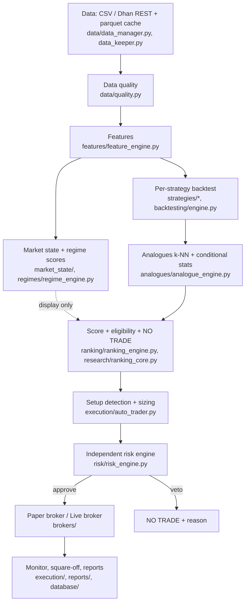

# Nifty Intelligence: project audit

Audit date 2026-10-16. Method: read the code on the real execution paths, ran the test suite, compiled and imported every
module, ran every page headlessly, ran probes on the real cached candles, and fixed confirmed defects with regression
tests. README / docstring claims were checked against code, not trusted.

Classification: **WORKING** (verified by a test or direct execution) · **NEEDS FIXING** (reproducible defect) ·
**INCOMPLETE** · **NOT IMPLEMENTED** · **UNVERIFIED**. "Fixed" means fixed in this session, with a regression test.

Companion documents: `STRATEGY_AUDIT.md`, `RISK_AND_EXECUTION_AUDIT.md`, `SELECTOR_EVALUATION.md`, `TEST_BASELINE.md`,
`UI_REDESIGN_PLAN.md`.

## 1. Architecture

**Differences from the intended workflow (verified):** the regime is **not** an input to analogue selection or ranking
(it is display, logging and an order tag only: `regimes/regime_engine.py`, `execution/auto_trader.py`); backtests are
recomputed from scratch on every pipeline run and not persisted (`research/pipeline.py`, `persist=False`); setup detection
happens *after* ranking, per selected strategy.

## 2. Entry points

| Entry | Purpose |
|---|---|
| `streamlit run quant_intelligence/app.py` | Primary application. `app.py` is now a navigation router (five workspaces in a top bar); the Dashboard is `home_page.py`. |
| `python -m uvicorn quant_intelligence.web.app:app` | Read-only website (FastAPI + single-page app), added during this engagement at the owner's request. Streamlit remains the primary product. |
| `python -m quant_intelligence.ranking.evaluate_ranker` | Walk-forward selector evaluation. |
| `scripts/` | `init_db`, `migrate_db`, `smoke_test`, `ui_smoke_test`, `demo_preflight`, `purge_test_trades`, `prune_research_tables`, `evaluate_*`. |

## 3. Module responsibilities (size from line counts)

`strategies/` (17 strategies, ~1.6 kLOC) · `execution/` (auto trader, engine threads, monitor, square-off, ~1.6 kLOC) ·
`brokers/` (Dhan client/auth/rate-limit/broker, paper broker, ~1.1 kLOC) · `data/` + `data_adapters/` (~1.7 kLOC) ·
`reports/` (~1.1 kLOC) · `volatility/` (~1.1 kLOC; optional option-premium models, off by default) · `options/` (chain
analytics, contract selection) · `ranking/`, `research/`, `analogues/`, `regimes/`, `backtesting/`, `risk/`, `features/` ·
`ui/` + `pages/` (~4.9 kLOC) · `web/` (read-only site) · `tests/` (~7.2 kLOC, 50+ files). `ai/` and `portfolio/` contain
only an empty `__init__.py`: **NOT IMPLEMENTED placeholders**.

## 4. Verified behaviour of the research core

| Component | Finding | Class |
|---|---|---|
| Features | Backward-looking; whole-session aggregates checked. One look-ahead found and fixed (opening range). `tests/test_chronology.py` proves every column is unchanged when future bars are removed. | WORKING (fixed) |
| 17 strategies | 13 implemented, 4 option-chain strategies have no historical setups and can never be ranked (`STRATEGY_AUDIT.md`). | WORKING / INCOMPLETE |
| Backtester | Entry at the signal bar's close (optimistic); stop-first on same-bar collisions; **fixed:** gap-through-stop fills, open trades at data end, wrong-side targets, Sharpe/Sortino annualisation. | WORKING (fixed) |
| Analogues | k-NN (k = 30) on 6 z-scored features; z-score uses only the observations passed in; NaNs mean-imputed; top-k are returned regardless of similarity (no rejection of poor matches); similarity = 1 - distance / max distance, so it is relative, not calibrated. Confidence counts distinct trading days, and the standard error is day-clustered: good practice. | WORKING, with limits |
| Regime | Hand-written scores through a softmax: **not calibrated probabilities** (labelled so everywhere now). Not used downstream. | WORKING (relabelled) / INCOMPLETE as a model input |
| Ranking | Score = 0.5·(shrunk lower-bound edge) + 0.3·(P(win) - 0.5) + 0.3·confidence - 0.2·drawdown penalty; eligibility = shrunk edge >= 0.05 R, confidence >= MEDIUM, edge positive in >= 50 % of time folds. Weights are heuristic, no significance test, no correction for choosing the best of 17. | WORKING; **statistically UNVERIFIED** |
| Tie-break | Top two statistically tied: trade the leader at half size, tagged. No demonstrated edge. Paper default on; **live default now off**. | NEEDS FIXING (fixed) |
| Selector evaluation | Walk-forward evaluator is chronologically sound; baselines added (fixed-on-warm-up, regime-based). **No evidence of edge**; underpowered (`SELECTOR_EVALUATION.md`). | WORKING; edge UNVERIFIED |

## 5. Defects found

### Fixed this session (each has a regression test)

| # | Defect | Where | Severity |
|---|---|---|---|
| 1 | Opening range used a whole-session max: bars in the first 30 min saw the completed range (look-ahead). Old test pinned the leak. | `features/feature_engine.py` | P1 research |
| 2 | Stops filled at the stop price even when the bar gapped through it (backtest and both position monitors). | `strategies/base_strategy.py`, `execution/position_monitor.py` | P1 research / P&L |
| 3 | Trades still open when the data ends were booked as closed and fed into the live analogues (0.5 % of trades on real data). | `base_strategy.simulate_trade`, `backtesting/engine.run_backtest` | P2 research |
| 4 | Targets already on the wrong side of the entry (4.5 % Bollinger, 5.2 % Camarilla setups) simulated as instant "wins". | `run_backtest` + `setup_geometry_ok` | P2 research |
| 5 | Sharpe/Sortino annualised per-trade R by sqrt(252). Now daily net R, NaN under 10 days. | `backtesting/engine.daily_sharpe_sortino` | P2 |
| 6 | Paper `net_pnl` had no brokerage/taxes/exit slippage. | `brokers/paper_broker.py`, `brokers/paper_costs.py` | P1 P&L |
| 7 | Risk engine lacked entry/stop/quantity validity, price staleness and spread/slippage vetoes. | `risk/risk_engine.py` | P0 safety |
| 8 | Live broker did not verify a risk approval; a request timeout raised an unhandled exception while the order might have been placed. | `brokers/dhan_broker.py` | P0 safety |
| 9 | Live account state overwrote the paper engine's peak equity and used the paper engine's P&L for the live daily-loss check; missing P&L was treated as zero. | `ui/state.py`, `risk_engine.AccountState` | P1 safety |
| 10 | `TIE_BREAK_LIVE` defaulted on, contradicting the README. | `config/settings.py` | P1 safety |
| 11 | Cache replace/read raised `PermissionError` on Windows when a reader had the file open; a transient lock made `_read_cache` look "unreadable" and re-fetch from Dhan. | `data/data_manager.py` | P2 reliability |
| 12 | Persistence failures swallowed by bare `except: pass` (orders, fills, positions, risk events). Now logged at ERROR. | `brokers/paper_broker.py`, `risk/risk_engine.py` | P2 |
| 13 | A rejected or blocked live order consumed a daily trade slot. | `pages/12_Live_Options_Trading.py` | P3 |
| 14 | Each new Streamlit session re-ran the ~40 s pipeline; a visitor arriving during warm-up ran it twice. Shared stale-while-revalidate cache added. | `research/shared_cache.py`, `ui/state.py`, `app.py` | P1 presentation |
| 15 | Regime "probabilities", "validated edge" wording, stale "adapter not implemented" text, README clone URL. | `app.py`, README, UI | P2 honesty |
| 16 | Demo lockdown still showed the last 4 characters of the access token. | `ui/credentials_panel.py` | P2 security |

### Still open

* **P1** Backtest entries fill at the signal bar's close; no latency or next-bar-open model (optimistic).
* **P1** Option premium and delta are *assumed* constants in the cost model; real option history is not used. Never present results as actual fills.
* **P1** Four chain-aware strategies are live-only and cannot be ranked or validated.
* **P1** The selector's edge is unestablished (`SELECTOR_EVALUATION.md`); only ~2.5 months of 5-minute data are cached.
* **P2** Spread/slippage veto is dormant until callers supply bid/ask. Margin for written options is not modelled.
* **P2** Live positions have no stop at the broker and are not monitored by this software.
* **P2** No automatic broker reconciliation after an unknown order outcome (a human must check).
* **P2** Equity/futures statutory charges are not modelled in paper P&L.
* **P2** Per-strategy tests are smoke-level: no per-strategy entry-correctness tests.
* **P2** `ENGINE`/`COMMODITY_RUNNER` singleton thread-safety not audited.
* **P3** `psycopg2-binary` is a hard requirement although SQLite is the default; `gap_fill` declares an unused `cooldown_bars`.

## 6. Testing limitations

All tests use synthetic or mocked inputs (seeded `SyntheticAdapter`, `MagicMock` Dhan client). No test touches a real
broker or the network, which is deliberate. Therefore: live order placement, real response shapes, rate-limit behaviour
against Dhan and real option-chain data are **UNVERIFIED**. The chronology tests detect the specific tamperings they
apply; they do not prove the absence of every leak. See `TEST_BASELINE.md`.

## 7. Security and trading safety

* Secrets: `.env` is git-ignored and was never committed; no JWT-like string exists in tracked files, logs or cached
  data (`git grep`, directory scan). Credentials are read from the environment; the UI masks them, and in
  `DEMO_LOCKDOWN` shows only token state and expiry.
* The website has no order endpoints and no credential endpoint.
* **Local-machine risk:** `.env` already contains the live-trading confirmation phrase, so `TRADING_MODE=LIVE` alone opens
  the first live gate. Use `DEMO_LOCKDOWN=1` for any demo; consider removing the phrase from `.env`.
* The Dhan token expires about every 24 h: renew before use (`scripts/demo_preflight.py` checks).
* Devcontainer disables Streamlit XSRF/CORS protection: acceptable only for private Codespaces.

## 8. Remediation priorities

1. **P0** Before any live use: paper-trade for weeks; verify the live path with a funded test account and Dhan's order book; add broker-side stops and reconciliation.
2. **P1** Obtain longer history (several years) and re-run `SELECTOR_EVALUATION.md` with a pre-registered plan; add real option-chain history if available.
3. **P1** Add latency/next-bar-open fill model and test its effect on rankings.
4. **P2** Per-strategy entry-correctness tests; supply bid/ask to the risk engine; model margin; audit engine thread-safety.
5. **P3** Dependency hygiene (`psycopg2-binary` optional), dead parameters.
